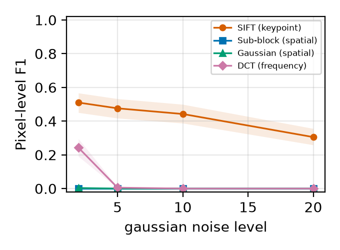
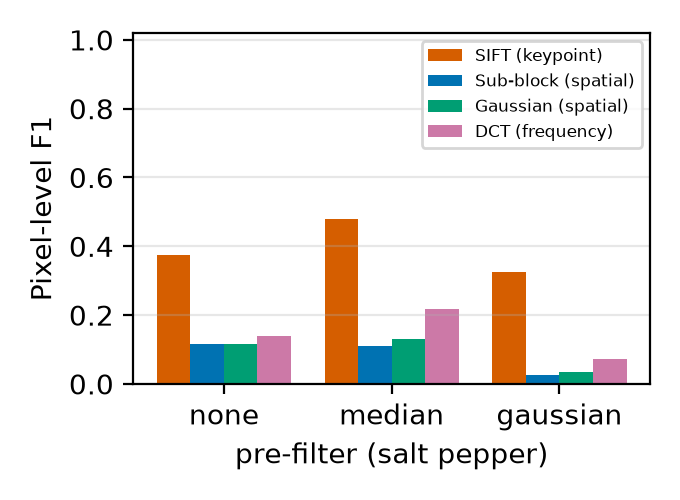

# Hasil Eksperimen

Paper: Performance Evaluation of Spatial and Frequency Features for Block-Based Copy-Move Forgery Detection
Kelompok: Kelas C, Kelompok 7

Berkas ini adalah pintu masuk ke semua hasil. Setiap bagian punya tiga lapis:
1. DATA: tabel atau grafik (angka dari CSV, bukan diketik dari ingatan).
2. GAMBAR: visualisasi yang memperlihatkan hasilnya.
3. PENJELASAN: apa artinya, ditulis dengan tiga bagian (Fakta, Interpretasi, Kaitan).

Cara menulis blok PENJELASAN:
- Fakta: apa yang terlihat di angka atau gambar. Sebut angka konkret. Tidak ada opini.
- Interpretasi: mengapa itu terjadi. Jika belum diuji, tulis "dugaan:" di depannya.
- Kaitan: hubungkan dengan hipotesis (H1 sampai H4) atau teori dari materi kuliah.

Letak gambar dari skrip: experiments/paper/results/figures/. Dari berkas ini (experiments/paper/data/) path relatifnya adalah ../results/figures/.

---

## 0. Ringkasan temuan utama (isi terakhir)

1. Pada E1 (140 citra palsu dan 140 citra asli), SIFT memberikan F1 piksel rata-rata tertinggi, 0,5119, sekaligus waktu median tercepat, 478,8 ms per citra.
2. A dan B lebih konservatif: FPR citra masing-masing hanya 0,0786 dan 0,1071, tetapi recall pikselnya rendah (0,1702 dan 0,1851).
3. DCT mendeteksi lebih banyak citra palsu daripada A dan B (TPR 0,7857), tetapi FPR tertinggi (0,5214); hampir separuh citra asli ditandai positif.
4. E2 memilih block size 8 dan threshold 5 untuk A, B, dan DCT; untuk SIFT, nilai terbaik pada tuning adalah ratio threshold 0,7 dan minimum inlier 4.

---

## 1. Lingkungan dan konfigurasi

| Item | Isi |
|---|---|
| Tanggal eksperimen | |
| Pelaksana | |
| Sistem operasi | |
| CPU / jumlah core | |
| RAM | |
| Versi Python / OpenCV / NumPy | |
| Branch / commit repo | |
| Jumlah worker (--workers) | |
| Waktu total menjalankan eksperimen | |

Parameter beku hasil tuning (salin dari best_config.json):

| Metode | Parameter | Nilai |
|---|---|---|
| SIFT | ratio_threshold, min_inliers | |
| A (sub-block) | block_size, threshold_t, eps | |
| B (Gaussian) | block_size, threshold_t, eps, gaussian_sigma | |
| DCT | block_size, threshold_t, eps, n_coeffs | |

Parameter tetap untuk semua: stride 1, d_min, area_min, min_std, shift_tol, match_method.

---

## 2. Data yang dipakai

| Item | Isi |
|---|---|
| Dataset | CoMoFoD (set kecil 512x512) |
| Jumlah set yang ditemukan | |
| Jumlah set dipakai (--n-sets) | |
| Seed | |
| Jumlah set tuning (30 persen) | |
| Jumlah set pengujian (70 persen) | |
| Mode mask (--mask-mode) | B / M / union |
| Alasan memilih mode mask (hasil check_masks) | |
| Jumlah citra palsu / asli di pengujian | |

Contoh citra dari dataset (satu set lengkap):

| Citra palsu (F) | Citra asli (O) | Mask B | Mask M |
|---|---|---|---|
|  |  |  |  |

---

## 3. Hasil kuantitatif (dari skrip)

### 3.1 Citra bersih (E1)

DATA (dari `../results/figures/table_e1_clean.csv`). F1, precision, recall, dan IoU adalah rata-rata per citra palsu (n = 140); TPR/FPR adalah proporsi prediksi positif pada citra palsu/asli.

| Metode | Precision | Recall | F1 | IoU | TPR citra | FPR citra | Waktu median (ms) |
|---|---|---|---|---|---|---|---|
| SIFT | 0,5449 | 0,6248 | **0,5119** | **0,4108** | **0,9143** | 0,4500 | **478,8** |
| A (sub-block) | 0,3144 | 0,1702 | 0,1847 | 0,1664 | 0,3857 | **0,0786** | 10.966,4 |
| B (Gaussian) | 0,3660 | 0,1851 | 0,2050 | 0,1784 | 0,4571 | 0,1071 | 14.128,9 |
| DCT | **0,4097** | 0,3186 | 0,2743 | 0,2107 | 0,7857 | 0,5214 | 9.838,1 |

GAMBAR: 

PENJELASAN:
- Fakta: SIFT memiliki F1 dan IoU rata-rata tertinggi, yaitu 0,5119 dan 0,4108. Metode ini juga mendeteksi 128 dari 140 citra palsu (TPR 0,9143), tetapi memberikan alarm pada 63 dari 140 citra asli (FPR 0,4500). A memiliki FPR terendah, 0,0786 (11 dari 140 citra asli), namun TPR-nya hanya 0,3857. DCT mempunyai FPR tertinggi, 0,5214 (73 dari 140 citra asli).
- Interpretasi: SIFT berbasis keypoint dapat menemukan korespondensi yang cukup stabil pada banyak pemalsuan sehingga recall dan F1-nya paling baik, serta hanya menghitung deskriptor di titik-titik penting; ini konsisten dengan waktu median yang jauh lebih singkat. Sebaliknya, A, B, dan DCT memeriksa blok secara rapat (stride 1), sehingga lebih lambat. Ambang dan penyaringan pasangan blok yang dipakai tampak sangat ketat bagi A/B: false positive turun, tetapi banyak area salinan tidak terdeteksi. DCT lebih sensitif, namun sensitivitas tersebut diikuti alarm palsu yang tinggi.
- Kaitan (hipotesis atau teori): Hasil ini mendukung perbandingan fitur lokal dan fitur blok pada citra bersih: fitur lokal SIFT memberi kompromi terbaik antara ketelitian lokalisasi, tingkat deteksi citra, dan waktu. Precision/recall perlu dibaca bersama FPR; TPR tinggi saja tidak cukup apabila banyak citra asli ikut terdeteksi sebagai palsu.

### 3.2 Tuning parameter (E2)

DATA (dari `e2_tune.csv` dan `../results/figures/summary.csv`). Angka F1 adalah rata-rata per citra palsu pada subset tuning (n = 60). Setiap parameter diuji secara terpisah; nilai dengan F1 tertinggi dipilih dan kemudian dibekukan untuk E1.

| Metode | Parameter | Nilai yang dicoba | F1 per nilai | Nilai terpilih |
|---|---|---|---|---|
| A | block_size | 8, 16, 32 | 0,2045; 0,1952; 0,1286 | **8** |
| A | threshold_t | 5, 10, 20, 40 | 0,2034; 0,1946; 0,1773; 0,1732 | **5** |
| B | block_size | 8, 16, 32 | 0,2199; 0,1898; 0,1200 | **8** |
| B | threshold_t | 5, 10, 20, 40 | 0,1939; 0,1755; 0,1721; 0,1721 | **5** |
| DCT | block_size | 8, 16, 32 | 0,3047; 0,2833; 0,2024 | **8** |
| DCT | threshold_t | 5, 10, 20, 40 | 0,2828; 0,2811; 0,2627; 0,2509 | **5** |
| SIFT | ratio_threshold | 0,6; 0,7; 0,8 | 0,5290; 0,5447; 0,5249 | **0,7** |
| SIFT | min_inliers | 4, 6, 10 | 0,5398; 0,5325; 0,4711 | **4** |

PENJELASAN:
- Fakta: Untuk seluruh metode blok, block size 8 menghasilkan F1 tertinggi dibanding 16 dan 32: A 0,2045, B 0,2199, dan DCT 0,3047. Threshold 5 juga tertinggi untuk ketiganya. Pada SIFT, ratio threshold 0,7 memberi F1 0,5447, lebih tinggi daripada 0,6 (0,5290) dan 0,8 (0,5249). Minimum inlier 4 memberi F1 0,5398; nilai 10 menurunkannya menjadi 0,4711.
- Interpretasi: Blok yang lebih kecil memberi resolusi spasial lebih rapat, sehingga area copy-move yang tidak besar tetap dapat dilokalisasi. Threshold yang lebih kecil mempertahankan lebih banyak pasangan blok potensial; pada data tuning ini, peningkatan pasangan benar lebih besar daripada tambahan kesalahan. Untuk SIFT, rasio 0,7 memberi titik tengah antara penolakan pasangan ambigu dan kehilangan pasangan yang benar. Syarat inlier 10 tampak terlalu ketat sehingga beberapa pemalsuan tidak memenuhi konsensus geometris.
- Kaitan: Tuning menunjukkan trade-off klasik pada sistem deteksi: parameter yang makin ketat umumnya mengurangi false positive, tetapi juga dapat menurunkan recall. Pemilihan dilakukan hanya pada subset tuning, lalu konfigurasi dibekukan sebelum E1, sehingga hasil E1 tetap merupakan evaluasi terpisah dan tidak memakai data uji untuk memilih parameter.

Catatan disiplin: parameter dipilih hanya dari subset tuning, lalu dibekukan sebelum pengujian.

### 3.3 Ketahanan terhadap noise, blur, dan JPEG (E3)

#### Noise Gaussian
GAMBAR: 

| Sigma | SIFT | A | B | DCT |
|---|---|---|---|---|
| 2 | | | | |
| 5 | | | | |
| 10 | | | | |
| 20 | | | | |

PENJELASAN:
- Fakta:
- Interpretasi:
- Kaitan (H2, materi restorasi dan spatial filtering):

#### Salt and pepper
GAMBAR: 

| Proporsi | SIFT | A | B | DCT |
|---|---|---|---|---|
| 0.01 | | | | |
| 0.02 | | | | |
| 0.05 | | | | |

PENJELASAN:
- Fakta:
- Interpretasi:
- Kaitan:

#### Blur Gaussian
GAMBAR: 

| Sigma | SIFT | A | B | DCT |
|---|---|---|---|---|
| 0.5 | | | | |
| 1.0 | | | | |
| 1.5 | | | | |
| 2.0 | | | | |

PENJELASAN:
- Fakta:
- Interpretasi:
- Kaitan:

#### Kompresi JPEG
GAMBAR: 

| Kualitas | SIFT | A | B | DCT |
|---|---|---|---|---|
| 90 | | | | |
| 70 | | | | |
| 50 | | | | |
| 30 | | | | |

PENJELASAN:
- Fakta:
- Interpretasi:
- Kaitan (H1, JPEG berbasis DCT):

Ringkasan ketahanan: metode mana yang turun paling lambat untuk tiap gangguan.

| Gangguan | Paling tahan | Paling rentan | Catatan |
|---|---|---|---|
| Noise Gaussian | | | |
| Salt and pepper | | | |
| Blur | | | |
| JPEG | | | |

### 3.4 Perubahan kontras (E4)

GAMBAR: 

| Kondisi | SIFT | A | B | DCT |
|---|---|---|---|---|
| Gamma 0.7 | | | | |
| Gamma 1.3 | | | | |
| Gamma 1.6 | | | | |
| Histogram equalization | | | | |

PENJELASAN:
- Fakta:
- Interpretasi:
- Kaitan (materi transformasi intensitas dan histogram):

### 3.5 Efek pra-filter (E5)

GAMBAR:



| Noise | Pra-filter | SIFT | A | B | DCT |
|---|---|---|---|---|---|
| Salt and pepper 0.02 | none | | | | |
| Salt and pepper 0.02 | median | | | | |
| Salt and pepper 0.02 | gaussian | | | | |
| Noise Gaussian sigma 10 | none | | | | |
| Noise Gaussian sigma 10 | median | | | | |
| Noise Gaussian sigma 10 | gaussian | | | | |

PENJELASAN:
- Fakta:
- Interpretasi:
- Kaitan (H4, materi 7 dan 9a):

### 3.6 Biaya komputasi

| Metode | Waktu median (ms) | Waktu terlama (ms) | Catatan |
|---|---|---|---|
| SIFT | | | |
| A | | | |
| B | | | |
| DCT | | | |

PENJELASAN:
- Fakta:
- Interpretasi:
- Kaitan (alasan stride 1):

---

## 4. Hasil kualitatif (studi kasus dan panel gambar)

Catatan: contoh dipilih untuk ilustrasi, bukan sampel acak. Pengaturan Streamlit atau skrip yang dipakai: ______

### 4.1 Daftar citra studi kasus

| ID | Berkas | Alasan dipilih |
|---|---|---|
| C1 | | |
| C2 | | |
| C3 | | |
| C4 | | |

### 4.2 Panel perbandingan (satu baris per citra)

| Citra | Mask kunci | SIFT | A | B | DCT |
|---|---|---|---|---|---|
| C1 |  |  |  |  |  |
| C2 | | | | | |
| C3 | | | | | |
| C4 | | | | | |

Saran: gunakan peta kesalahan berwarna (hijau benar terdeteksi, merah salah tuduh, biru terlewat) agar kesalahan langsung terlihat.

### 4.3 Dampak gangguan pada satu citra (opsional)

| Kondisi | Citra | SIFT | A | B | DCT |
|---|---|---|---|---|---|
| Bersih |  | | | | |
| Gaussian sigma 10 |  | | | | |
| JPEG Q30 |  | | | | |

### 4.4 Pengamatan per citra

Isi dengan fakta yang terlihat di gambar.

C1:
- SIFT:
- A:
- B:
- DCT:
- Ringkasan:

C2:
- SIFT:
- A:
- B:
- DCT:
- Ringkasan:

C3:
- SIFT:
- A:
- B:
- DCT:
- Ringkasan:

C4:
- SIFT:
- A:
- B:
- DCT:
- Ringkasan:

PENJELASAN KUALITATIF:
- Fakta:
- Interpretasi:
- Kaitan:

---

## 5. Analisis kasus gagal

| ID | Citra | Metode | Gambar | Fakta (angka dan pengamatan) | Dugaan penyebab | Terverifikasi? |
|---|---|---|---|---|---|---|
| G1 | | |  | | | |
| G2 | | |  | | | |
| G3 | | |  | | | |

Contoh bentuk fakta: "SIFT: 2560 titik kunci, 29 pasangan lolos ratio test, 0 lolos verifikasi geometri, status tidak terindikasi pada citra palsu."

PENJELASAN:
- Pola kegagalan yang berulang:
- Apakah penyebabnya dari data (misalnya rotasi atau skala), dari parameter, atau dari metode:
- Dampak ke kesimpulan:

---

## 6. Hubungan dengan hipotesis

| Hipotesis | Hasil (didukung, sebagian, tidak didukung) | Bukti (angka atau gambar) | Penjelasan |
|---|---|---|---|
| H1. DCT lebih tahan JPEG | | | |
| H2. Fitur Gaussian (B) tahan noise tetapi kurang tajam | | | |
| H3. SIFT recall tinggi tetapi rawan alarm palsu | | | |
| H4. Median untuk salt and pepper, Gaussian untuk noise Gaussian | | | |

Jika hasil berlawanan dengan hipotesis, tulis apa adanya dan bahas alasannya. Jangan mengubah hipotesis agar cocok.

---

## 7. Keterbatasan

- Jumlah citra dan satu dataset saja:
- Parameter dikalibrasi pada subset kecil:
- Jenis pemalsuan yang tidak diuji (rotasi, skala, dan lainnya) atau yang ikut dalam dataset:
- Perangkat dan waktu:
- Lainnya:

---

## 8. Lampiran: jejak data

| Berkas | Isi | Lokasi |
|---|---|---|
| e2_tune.csv | hasil tuning | experiments/paper/results/ |
| e1.csv | hasil citra bersih | experiments/paper/results/ |
| e345.csv | hasil gangguan dan pra-filter | experiments/paper/results/ |
| best_config.json | parameter beku | experiments/paper/results/ |
| summary.csv | ringkasan | experiments/paper/results/figures/ |
| errors.csv | deteksi gagal | experiments/paper/results/figures/ |

Perintah yang dijalankan (salin persis):

```
(tempel perintah tuning)
(tempel perintah E1)
(tempel perintah E3 sampai E5)
(tempel perintah make_figures)
```

Daftar periksa:
- [ ] Semua angka berasal dari CSV, bukan diketik dari ingatan
- [ ] Parameter dibekukan sebelum pengujian
- [ ] Setiap gambar punya penjelasan di bawahnya
- [ ] Setiap penjelasan memisahkan fakta, interpretasi, dan kaitan
- [ ] Dugaan ditandai sebagai dugaan
- [ ] Spesifikasi komputer terisi
- [ ] Tidak ada kesimpulan umum dari studi kasus kecil
