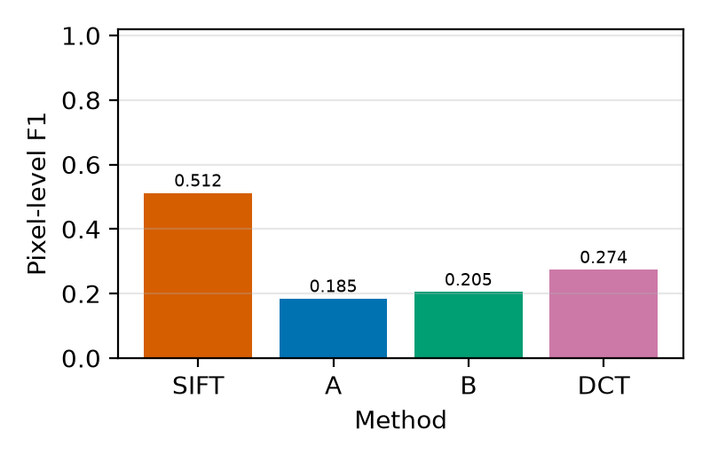
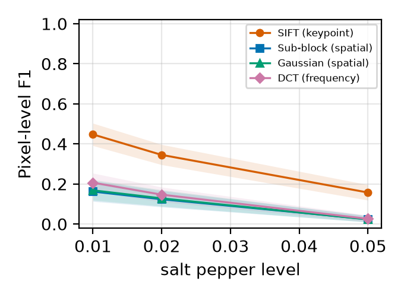
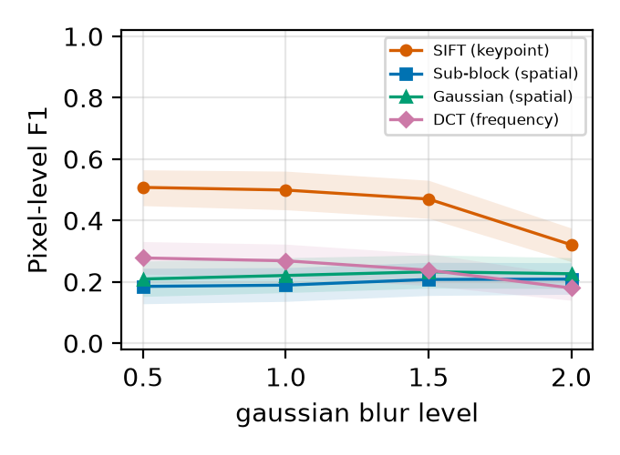
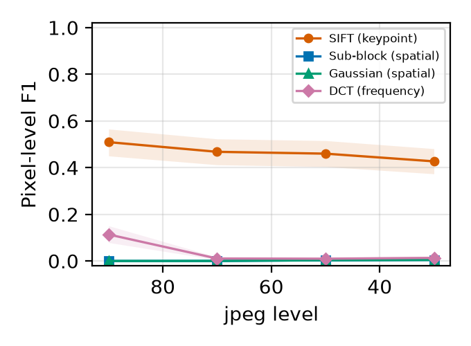
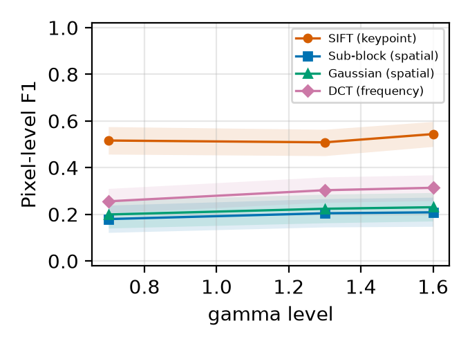
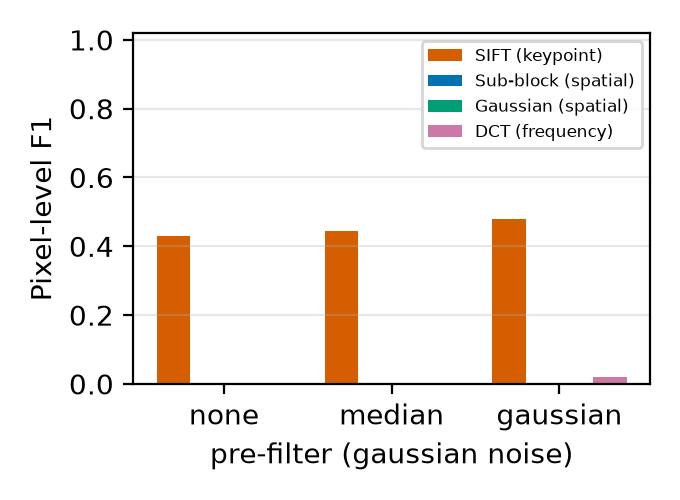

# Hasil Eksperimen

*Performance Evaluation of Spatial and Frequency Features for Block-Based Copy-Move Forgery Detection*  
Kelas C — Kelompok 7

## Ringkasan

Eksperimen membandingkan SIFT, fitur sub-block (A), fitur Gaussian (B), dan DCT untuk deteksi copy-move forgery pada CoMoFoD. Parameter dipilih pada subset tuning, kemudian dibekukan sebelum evaluasi pada data uji.

- Pada citra bersih, **SIFT** memiliki F1 piksel tertinggi (0,5119) dan waktu median tercepat (478,8 ms per citra).
- Metode **A** paling konservatif terhadap citra asli (FPR 0,0786), tetapi recall pikselnya paling rendah.
- Pada seluruh gangguan E3, **SIFT** tetap memberi F1 tertinggi. DCT, A, dan B sangat rentan terutama terhadap JPEG dan noise Gaussian.
- Median filter paling membantu salt-and-pepper, sedangkan Gaussian filter paling membantu noise Gaussian—terutama untuk SIFT.

## 1. Konfigurasi eksperimen

| Item | Nilai |
|---|---|
| Dataset | CoMoFoD set kecil, 512×512 piksel |
| Pembagian data | 60 set tuning (30%) dan 140 set uji (70%) |
| Seed | 1000 |
| Ground-truth mask | Mask B |
| Worker | 10 |
| Sistem | Linux x86_64, 12 logical cores |
| Perangkat lunak | Python 3.12.13, OpenCV 5.0.0, NumPy 2.5.4 |
| Durasi seluruh benchmark E1–E5 | 13.973 detik (±3 jam 53 menit) |

Konfigurasi yang dipilih dari E2:

| Metode | Parameter terpilih |
|---|---|
| SIFT | `ratio_threshold=0.7`, `min_inliers=4` |
| A | `block_size=8`, `threshold_t=5`, `eps=1.0` |
| B | `block_size=8`, `threshold_t=5`, `eps=1.0`, `gaussian_sigma=1.0` |
| DCT | `block_size=8`, `threshold_t=5`, `eps=1.0`, `n_coeffs=16` |

Parameter tetap untuk metode blok adalah `stride=1`, `d_min=30`, `area_min=100`, `min_std=2.0`, `shift_tol=1`, dan `match_method=lexsort`.

## 2. Hasil pada citra bersih (E1)

E1 menggunakan 140 citra palsu dan 140 citra asli. Precision, recall, F1, dan IoU adalah rata-rata pada citra palsu; TPR dan FPR adalah proporsi prediksi positif pada citra palsu dan citra asli.

| Metode | Precision | Recall | F1 | IoU | TPR citra | FPR citra | Waktu median (ms) |
|---|---:|---:|---:|---:|---:|---:|---:|
| SIFT | **0,5449** | **0,6248** | **0,5119** | **0,4108** | **0,9143** | 0,4500 | **478,8** |
| A (sub-block) | 0,3144 | 0,1702 | 0,1847 | 0,1664 | 0,3857 | **0,0786** | 10.966,4 |
| B (Gaussian) | 0,3660 | 0,1851 | 0,2050 | 0,1784 | 0,4571 | 0,1071 | 14.128,9 |
| DCT | 0,4097 | 0,3186 | 0,2743 | 0,2107 | 0,7857 | 0,5214 | 9.838,1 |

SIFT memberikan keseimbangan terbaik antara lokalisasi, kemampuan mendeteksi citra palsu, dan waktu proses. Ia mendeteksi 128 dari 140 citra palsu, tetapi juga memberi alarm pada 63 dari 140 citra asli. Sebaliknya, A dan B lebih ketat dalam memberi prediksi positif; konsekuensinya, false positive rendah tetapi banyak area salinan terlewat. DCT lebih sensitif daripada A dan B, namun FPR tertinggi menunjukkan bahwa sensitivitas tersebut dibayar dengan alarm palsu.

## 3. Pemilihan parameter (E2)

Tuning dilakukan pada 60 citra palsu. Setiap parameter diuji satu per satu; nilai dengan F1 rata-rata tertinggi dipilih sebelum E1–E5 dijalankan.

| Metode | Parameter | F1 pada nilai yang diuji | Nilai terpilih |
|---|---|---|---:|
| A | `block_size` = 8, 16, 32 | 0,2045; 0,1952; 0,1286 | **8** |
| A | `threshold_t` = 5, 10, 20, 40 | 0,2034; 0,1946; 0,1773; 0,1732 | **5** |
| B | `block_size` = 8, 16, 32 | 0,2199; 0,1898; 0,1200 | **8** |
| B | `threshold_t` = 5, 10, 20, 40 | 0,1939; 0,1755; 0,1721; 0,1721 | **5** |
| DCT | `block_size` = 8, 16, 32 | 0,3047; 0,2833; 0,2024 | **8** |
| DCT | `threshold_t` = 5, 10, 20, 40 | 0,2828; 0,2811; 0,2627; 0,2509 | **5** |
| SIFT | `ratio_threshold` = 0,6; 0,7; 0,8 | 0,5290; 0,5447; 0,5249 | **0,7** |
| SIFT | `min_inliers` = 4, 6, 10 | 0,5398; 0,5325; 0,4711 | **4** |

Ukuran blok 8 konsisten memberikan hasil terbaik untuk ketiga metode blok. Nilai threshold 5 menjaga lebih banyak pasangan kandidat sehingga F1 lebih tinggi pada data tuning. Pada SIFT, rasio 0,7 menjadi titik tengah antara menolak pasangan ambigu dan mempertahankan pasangan yang benar; syarat 10 inlier terlalu ketat dan menurunkan F1.

## 4. Ketahanan terhadap gangguan (E3)

E3 memakai 140 citra palsu pada setiap kondisi. Nilai pada tabel adalah F1 piksel rata-rata.

### Noise Gaussian

| Sigma | SIFT | A | B | DCT |
|---|---:|---:|---:|---:|
| 2 | **0,5101** | 0,0000 | 0,0034 | 0,2426 |
| 5 | **0,4759** | 0,0000 | 0,0000 | 0,0054 |
| 10 | **0,4423** | 0,0000 | 0,0000 | 0,0000 |
| 20 | **0,3054** | 0,0000 | 0,0000 | 0,0000 |

SIFT tetap mendeteksi sebagian area salinan sampai sigma 20. A dan B praktis gagal pada seluruh level, sedangkan DCT hanya bertahan pada noise rendah. Hipotesis bahwa fitur Gaussian B lebih tahan terhadap noise tidak didukung oleh hasil ini.

### Salt-and-pepper

| Proporsi | SIFT | A | B | DCT |
|---|---:|---:|---:|---:|
| 0,01 | **0,4472** | 0,1621 | 0,1681 | 0,2064 |
| 0,02 | **0,3450** | 0,1238 | 0,1281 | 0,1466 |
| 0,05 | **0,1573** | 0,0241 | 0,0230 | 0,0258 |

Semua metode menurun ketika proporsi piksel impulsif bertambah. SIFT masih unggul pada 0,05, tetapi penurunan ke F1 0,1573 menunjukkan bahwa gangguan ini berat bagi seluruh metode.

### Gaussian blur

| Sigma | SIFT | A | B | DCT |
|---|---:|---:|---:|---:|
| 0,5 | **0,5077** | 0,1851 | 0,2092 | 0,2778 |
| 1,0 | **0,4990** | 0,1892 | 0,2207 | 0,2685 |
| 1,5 | **0,4698** | 0,2077 | 0,2327 | 0,2380 |
| 2,0 | **0,3207** | 0,2088 | 0,2264 | 0,1799 |

SIFT memimpin pada setiap level blur, walaupun turun cukup tajam pada sigma 2,0. B paling stabil di antara metode blok pada blur berat, sedangkan DCT kehilangan lebih banyak detail berfrekuensi tinggi.

### Kompresi JPEG

| Kualitas | SIFT | A | B | DCT |
|---|---:|---:|---:|---:|
| 90 | **0,5093** | 0,0000 | 0,0000 | 0,1136 |
| 70 | **0,4678** | 0,0003 | 0,0003 | 0,0106 |
| 50 | **0,4599** | 0,0030 | 0,0034 | 0,0097 |
| 30 | **0,4269** | 0,0045 | 0,0047 | 0,0133 |

SIFT adalah metode paling tahan terhadap JPEG. DCT tidak memperoleh keuntungan praktis dari kesamaan transformasi dengan JPEG: kuantisasi JPEG tetap merusak koefisien yang diperlukan untuk pencocokan blok. Dengan demikian, hipotesis bahwa DCT paling tahan JPEG tidak didukung.

## 5. Perubahan kontras (E4)

| Kondisi | SIFT | A | B | DCT |
|---|---:|---:|---:|---:|
| Gamma 0,7 | **0,5162** | 0,1796 | 0,1993 | 0,2557 |
| Gamma 1,3 | **0,5084** | 0,2045 | 0,2238 | 0,3033 |
| Gamma 1,6 | **0,5438** | 0,2086 | 0,2303 | 0,3137 |
| Histogram equalization | **0,4675** | 0,1985 | 0,2148 | 0,2926 |

SIFT unggul pada semua transformasi kontras. Gamma 1,6 bahkan meningkatkan F1 seluruh metode dibanding sebagian besar kondisi lain, kemungkinan karena memperjelas tekstur lokal. Histogram equalization memberi F1 SIFT terendah dalam E4, tetapi hasilnya masih lebih baik daripada semua metode blok.

## 6. Efek pra-filter (E5)

| Noise | Pra-filter | SIFT | A | B | DCT |
|---|---|---:|---:|---:|---:|
| Salt-and-pepper 0,02 | Tanpa filter | 0,3742 | 0,1156 | 0,1156 | 0,1393 |
| Salt-and-pepper 0,02 | Median | **0,4786** | 0,1093 | **0,1307** | **0,2163** |
| Salt-and-pepper 0,02 | Gaussian | 0,3265 | 0,0270 | 0,0335 | 0,0738 |
| Gaussian sigma 10 | Tanpa filter | 0,4311 | 0,0000 | 0,0000 | 0,0000 |
| Gaussian sigma 10 | Median | 0,4441 | 0,0000 | 0,0000 | 0,0000 |
| Gaussian sigma 10 | Gaussian | **0,4803** | 0,0000 | 0,0000 | **0,0197** |

Median filter paling tepat untuk salt-and-pepper: F1 SIFT naik dari 0,3742 menjadi 0,4786, dan F1 DCT naik dari 0,1393 menjadi 0,2163. Sebaliknya, Gaussian filter merugikan seluruh metode pada gangguan impulsif. Untuk noise Gaussian, Gaussian filter meningkatkan F1 SIFT dari 0,4311 menjadi 0,4803 dan memulihkan DCT dari 0 menjadi 0,0197. Hasil ini mendukung hipotesis pra-filter, tetapi hanya sebagian karena A dan B tidak pulih pada noise Gaussian.

## 7. Biaya komputasi

| Metode | Waktu median E1 (ms) | Waktu maksimum E1 (ms) |
|---|---:|---:|
| SIFT | **478,8** | **1.642,7** |
| A | 10.966,4 | 31.694,2 |
| B | 14.128,9 | 36.763,5 |
| DCT | 9.838,1 | 30.355,2 |

SIFT sekitar 20,6 kali lebih cepat daripada DCT dan 29,5 kali lebih cepat daripada A pada waktu median. A, B, dan DCT membandingkan blok secara rapat dengan `stride=1`, sehingga jumlah kandidat pasangannya besar. Pengaturan ini menjaga resolusi lokalisasi, tetapi biayanya tinggi.

## 8. Kesimpulan terhadap hipotesis

| Hipotesis | Hasil | Ringkasan bukti |
|---|---|---|
| H1 — DCT lebih tahan JPEG | Tidak didukung | Pada JPEG Q30, F1 SIFT 0,4269 sedangkan DCT 0,0133. |
| H2 — B tahan noise tetapi kurang tajam | Tidak didukung | Pada Gaussian sigma 2, F1 B 0,0034 dan SIFT 0,5101. |
| H3 — SIFT recall tinggi tetapi rawan alarm palsu | Didukung | E1: TPR 0,9143 dan FPR 0,4500. |
| H4 — Median untuk salt-and-pepper, Gaussian untuk noise Gaussian | Didukung sebagian | Median membantu salt-and-pepper; Gaussian filter membantu SIFT pada noise Gaussian. |

Secara keseluruhan, SIFT adalah pilihan terbaik pada konfigurasi dan dataset ini apabila prioritasnya adalah F1, ketahanan terhadap gangguan, dan waktu proses. Metode blok dapat memberi FPR lebih rendah pada citra bersih, tetapi kualitas lokalisasi dan ketahanannya pada gangguan masih tertinggal.

## 9. Keterbatasan

- Evaluasi menggunakan satu dataset dan resolusi citra saja; hasil belum tentu sama pada dataset lain.
- Tuning dilakukan satu parameter pada satu waktu pada 60 set, sehingga interaksi antar-parameter belum dieksplorasi.
- E3–E5 hanya mengevaluasi citra palsu; FPR citra asli setelah diberi gangguan belum dihitung.
- Studi kasus visual per citra tidak disertakan pada dokumen ini dan perlu dipilih terpisah jika dibutuhkan untuk presentasi.

## Artefak hasil

| Berkas | Keterangan |
|---|---|
| `results/e1.csv` | Hasil citra bersih |
| `results/e2_tune.csv` | Data tuning parameter |
| `results/e3.csv`, `e4.csv`, `e5.csv` | Data gangguan, kontras, dan pra-filter |
| `results/figures/` | Tabel turunan dan seluruh grafik pada laporan |
| `results/best_config.json` | Konfigurasi beku hasil tuning |
